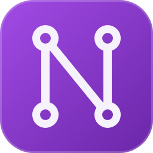
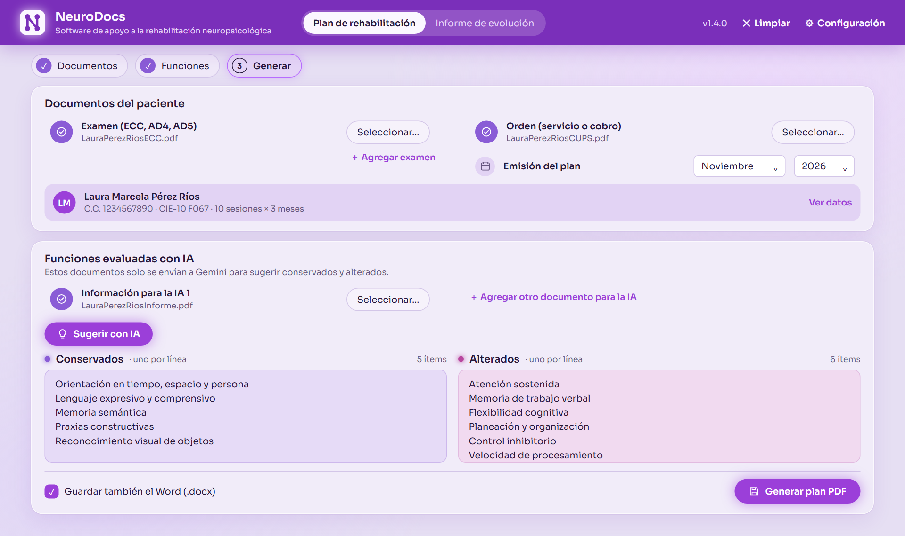
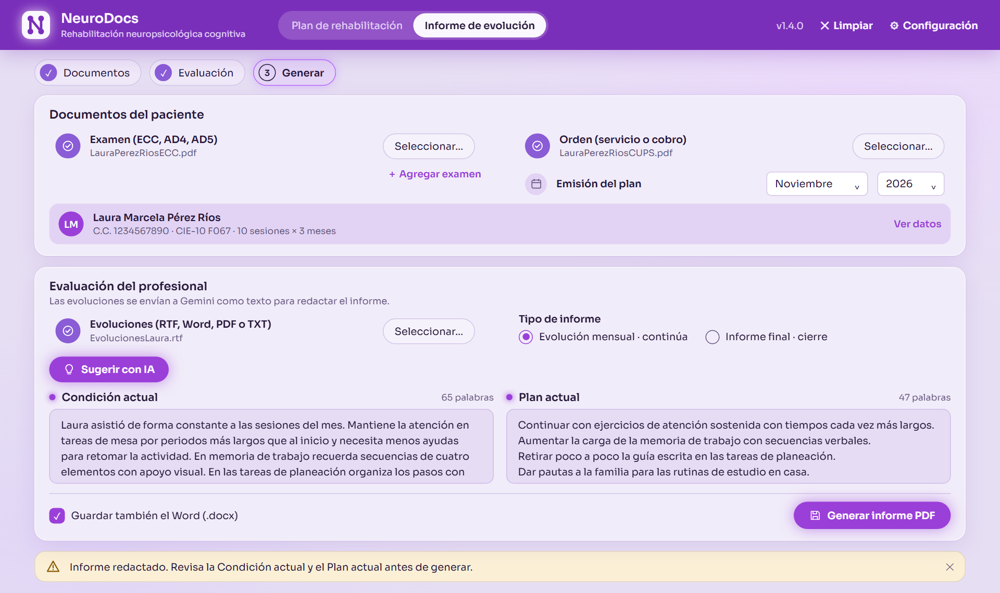
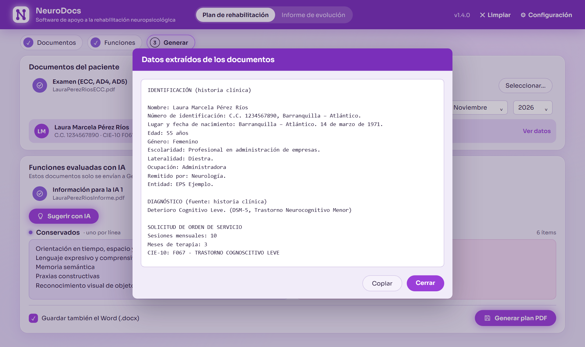
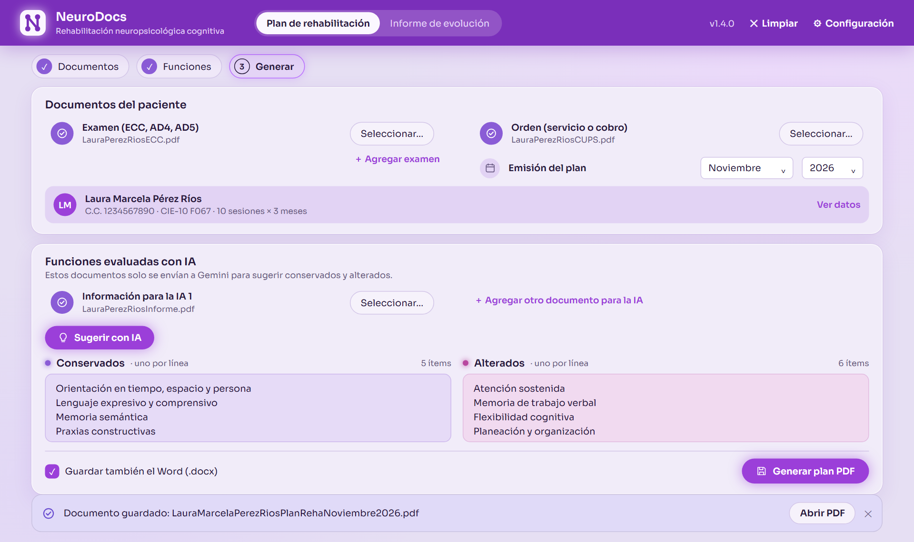

# NeuroDocs


Aplicación de escritorio para automatizar los planes de rehabilitación neuropsicológica cognitiva y los informes de evolución.

A partir del examen del paciente (historia clínica ECC, AD4 o AD5) y la orden en PDF (solicitud de orden de servicio CUPS u orden de cobro), NeuroDocs extrae los datos del paciente, el diagnóstico, el código CIE-10 y la duración de la terapia, e incorpora la firma del profesional. Con Gemini propone las funciones conservadas y alteradas a partir de los informes de las pruebas, y redacta el informe de evolución a partir de las evoluciones del profesional. El resultado sale en PDF (y opcionalmente en Word) desde la plantilla institucional.


## Funciones

- **Plan de rehabilitación**: datos del paciente, diagnóstico, CIE-10, sesiones y meses, emisión del plan y funciones conservadas y alteradas.
- **Informe de evolución**: mensual o final, con la condición actual y el plan actual redactados por la IA a partir de las evoluciones (RTF, Word, PDF o TXT).
- **Segundo examen opcional**: si hay dos exámenes, usa el más completo y avisa si los datos de identificación no coinciden.
- **Avisos de revisión**: documento equivocado, documentos que no coinciden, tiempo de terapia por defecto (editable en el mismo aviso) y sugerencias de la IA por revisar.
- **Edición antes de generar**: las listas y los textos sugeridos siempre se pueden corregir a mano.

## Requisitos

- Windows 10/11
- [.NET 10 SDK](https://dotnet.microsoft.com/download) (solo para compilar; la versión publicada es autocontenida)
- Microsoft Word (se usa para exportar a PDF)
- Clave de API de Gemini ([Google AI Studio](https://aistudio.google.com))

## Configuración

La clave y el modelo se configuran desde el botón **Configuración** de la aplicación (la clave se guarda cifrada en `%AppData%\NeuroDocs`). También se pueden usar variables de entorno:

| Variable de entorno | Descripción | Obligatoria |
|---|---|---|
| `GEMINI_API_KEY` | Clave de la API de Gemini | Sí, para usar la IA |
| `GEMINI_MODEL` | Modelo a usar (por defecto `gemini-3.8-flash`) | No |

```
setx GEMINI_API_KEY "tu_clave"
```

Las instrucciones que recibe Gemini están en `src/NeuroDocs/IA/*.txt` y se pueden ajustar sin recompilar.

## Compilar y publicar

```
dotnet build NeuroDocs.slnx
dotnet run --project src/NeuroDocs
dotnet test
```

`publicar.ps1` genera `publish/NeuroDocs-<versión>.zip`, un ejecutable autocontenido listo para copiar.

## Estructura

```
src/NeuroDocs/
├── Models/      Modelos de datos (paciente, orden, firma, plan, informe)
├── Services/    Extracción de PDF, parsers, generación Word/PDF, cliente de Gemini
├── Controls/    Selector de archivos, tarjetas y conversores de la interfaz
├── Temas/       Paleta de colores (Lavanda neón)
├── Fuentes/     Fuente Sora
├── Plantillas/  Plantillas Word del plan y del informe
└── IA/          Instrucciones para Gemini
tests/NeuroDocs.Tests/   Pruebas de los parsers y las reglas (xUnit)
```

## Uso

1. Elegir arriba el modo: **Plan de rehabilitación** o **Informe de evolución**.
2. Cargar el examen del paciente y la orden. Los datos se leen solos y aparece el resumen del paciente; **Ver datos** muestra todo lo extraído.
3. Elegir el mes de emisión del plan.
4. Plan: cargar los informes de las pruebas y pulsar **Sugerir con IA**, o escribir las funciones a mano.
   Informe: cargar las evoluciones, elegir el tipo (mensual o final) y pulsar **Sugerir con IA**.
5. Revisar el resultado y pulsar **Generar plan PDF** o **Generar informe PDF**.

## Capturas

Las capturas usan una paciente ficticia (Laura Pérez).

**Plan de rehabilitación:** documentos del paciente, funciones sugeridas por la IA y generación del plan.



**Informe de evolución:** evoluciones del profesional, tipo de informe y texto redactado por la IA.



**Datos extraídos:** vista previa de la información leída del examen y la orden.



**Plan generado:** el PDF (y el Word, si se marca) se guarda con el nombre del paciente, el tipo de documento y el mes, listo para abrir.



## Privacidad

Este repositorio no debe contener documentos de pacientes. El `.gitignore` excluye PDFs y documentos Word (salvo las plantillas) y la carpeta `muestras/`.
